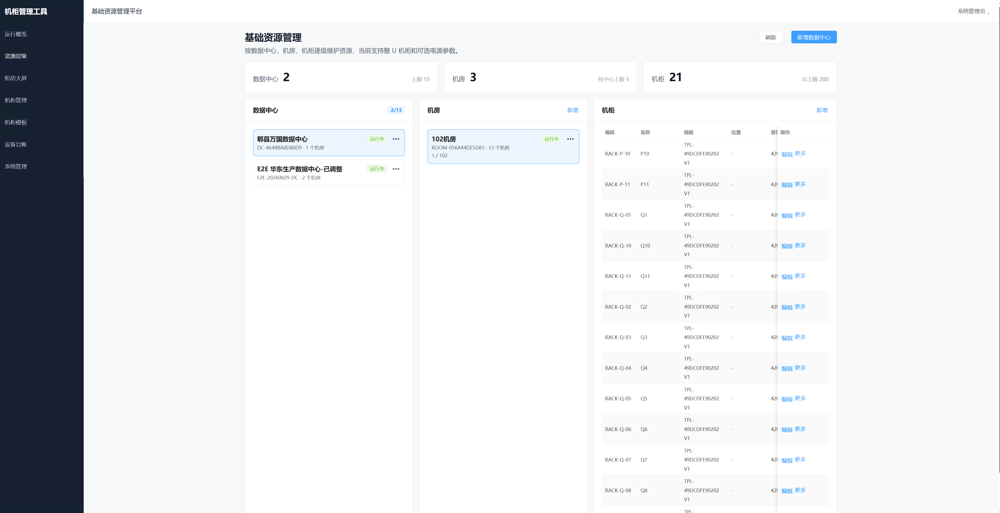
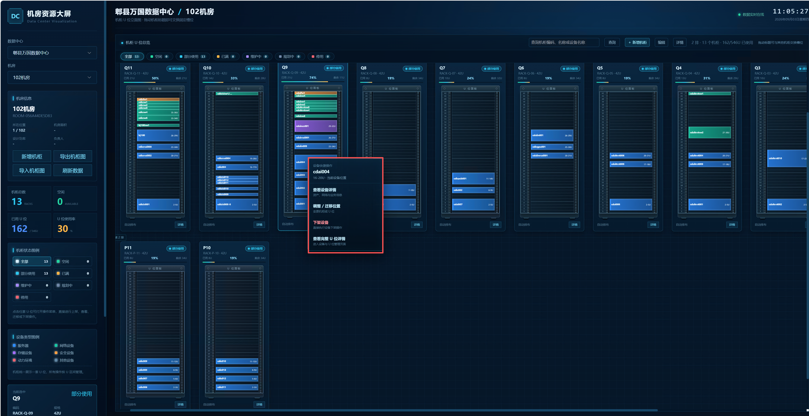
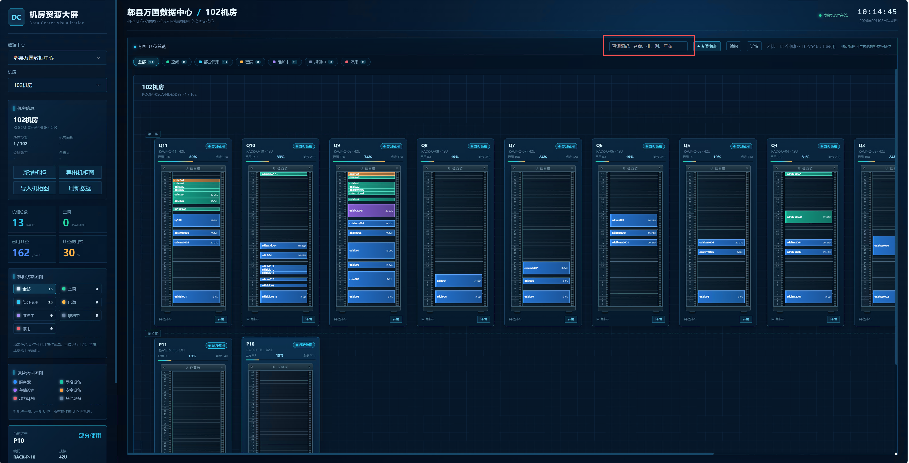
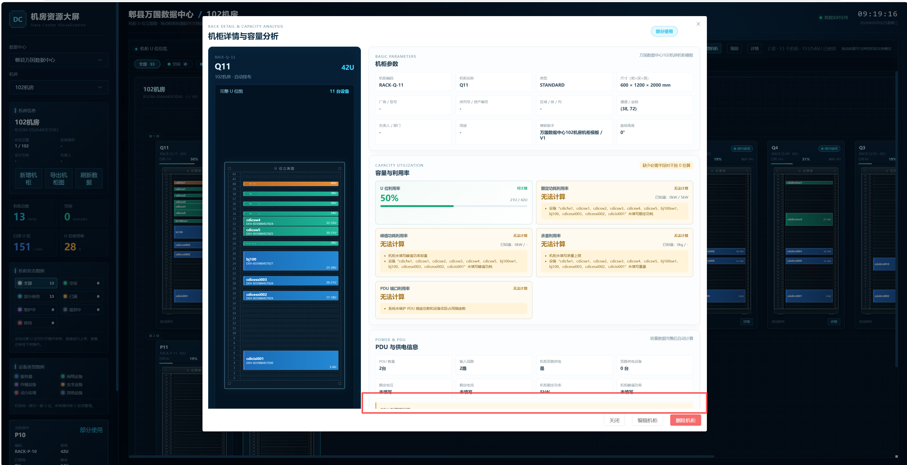
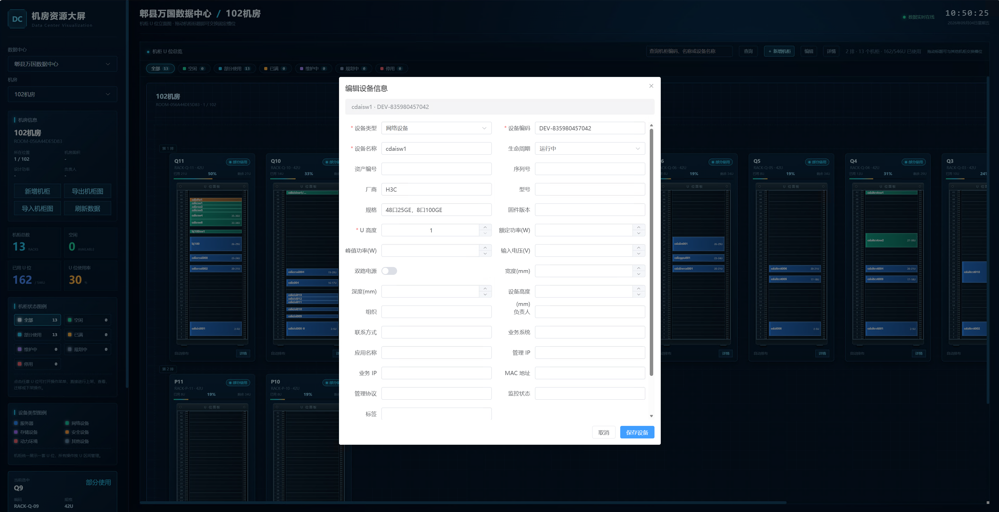
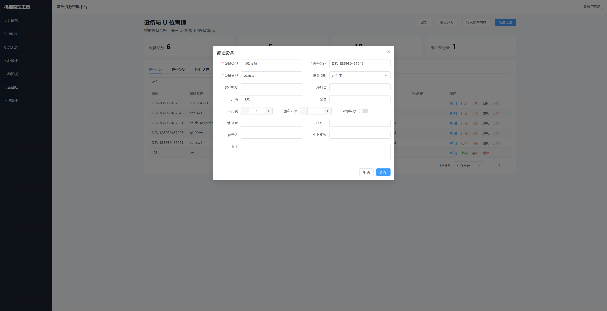

# 机柜管理工具
## 数据中心基础资源可视化管理平台

> **让每一台设备、每一个 U 位、每一次变更都清晰可见。**  
> 产品版本：**0.1.0** ｜ 文档版本：**1.0.0** ｜ 更新日期：**2026年9月4日**

## 1. 产品定位

机柜管理工具面向数据中心、机房、机柜和设备的日常管理，将资源台账、U 位布局、设备信息、容量分析和运维操作统一在一个平台中。系统以机房大屏为核心入口，以结构化数据为基础，帮助运维团队从“靠记忆、靠表格、靠现场查找”转向“可视、可查、可操作、可追溯”。

平台适合新建机房初始化、存量资源盘点、设备批量上架、设备迁移、机柜扩容、运维交接和多机房统一管理等场景。

## 2. 核心价值

- **资源全景可视化**：从数据中心到 U 位建立统一资源视图，机房状态一眼可见。
- **设备定位精确到 U 位**：通过设备名称搜索，快速定位设备所在机柜和 U 位，减少现场查找时间。
- **变更操作形成闭环**：设备上架、编辑、迁移、下架和归档均由业务流程管理，位置变化可追溯。
- **批量维护更高效**：提供机柜、设备和机柜图的 Excel 模板、导入、导出及回导能力。
- **容量分析更可信**：对 U 位、功耗、承重和 PDU 供电分别计算；条件不足时明确给出无法计算原因。
- **跨资源域调整更简单**：支持数据中心、机房和机柜复制，以及跨机房、跨数据中心移动资源。
- **权限管理更稳妥**：支持本地用户、角色权限、管理员审批和 LDAP 对接，满足团队化运维要求。

## 3. 产品能力总览

| 能力域 | 主要能力 |
|---|---|
| 资源管理 | 数据中心、机房、机柜的增删改查、状态维护、复制与层级浏览 |
| 机房大屏 | 多机柜网格展示、固定格位、拖动交换位置、动态扩展和换行 |
| U 位管理 | 空 U 位上架、有设备 U 位查看/编辑/迁移/下架，统一左键操作 |
| 设备台账 | 设备信息维护、自动编码、统一编辑、搜索定位、位置履历 |
| 模板与批量 | 机柜模板、机柜/设备批量导入、模板下载、设备信息导出后回导更新 |
| 机柜图 | 机柜图 Excel 导出与回导，支持导入验证和冲突检查 |
| 容量与供电 | U 位、功耗、承重、PDU 插座与供电连接关系分析 |
| 权限治理 | 用户管理、角色权限、管理员审批、LDAP 用户和组映射、操作审计 |

## 4. 重点功能展示

### 4.1 统一资源层级管理

系统按照“数据中心 → 机房 → 机柜 → U 位 → 设备”组织资源。管理人员可以在同一页面浏览层级关系、查看资源数量和状态，并直接新增、编辑或进入更多操作。

**使用价值**：避免数据中心、机房和机柜信息分散在不同表格中，建立统一资源主数据。

### 4.2 机房大屏与机柜可视化

机房大屏以固定格位展示机柜，机柜不会相互重叠；支持通过拖动交换位置，并按照机房配置自动扩展和换行。管理人员可在大屏上直接新增、编辑、删除机柜和修改机柜状态。

**使用价值**：将“机柜在哪里、空了多少、用了多少、状态如何”从表格信息变成直观空间视图。

### 4.3 U 位操作与设备生命周期

平台统一使用左键点击 U 位：空 U 位可直接上架设备，有设备的 U 位可查看详情、编辑设备信息、调整/迁移位置或执行下架。设备位置由后端业务规则校验，避免重叠和重复占用。

### 4.4 设备搜索与快速定位

输入设备名称并点击查询，即可在大屏中快速定位目标设备所在机柜及 U 位，适合设备巡检、故障处理和变更确认。

### 4.5 详情与容量分析

机柜详情左侧展示机柜图，右侧集中展示机柜参数、U 位利用率、功耗利用率、承重利用率和 PDU 端口利用率。设备或机柜未补充必要数据时，系统不将缺失值默认为 0，而是输出无法计算的具体原因。

### 4.6 统一设备编辑

设备台账和机房大屏共用同一套设备编辑表单，字段以后台数据模型为准，确保新增、编辑、详情、批量导入和导出回导之间的数据一致。

支持设备名称、设备编号、类型、厂商、型号、序列号、管理 IP、业务 IP、功耗、U 高度、负责人、用途和备注等信息；设备编号支持自动生成，也支持按管理规范手工维护。

### 4.7 模板、批量导入与设备信息回导

平台提供清晰的 Excel 模板，区分必填字段和可选字段，并提供示例、字段说明和校验提示。普通机柜和设备批量导入不要求填写编码，编码为空时由系统自动生成。

设备信息可先导出，再补充管理 IP、业务 IP、SN、功耗等字段后重新导入更新。机柜图也支持导出和回导，导入阶段先执行格式、设备识别、位置占用和重复数据验证，确认后再提交变更，降低数据错乱风险。

### 4.8 复制与跨机房/跨数据中心移动

支持复制数据中心、机房和机柜，用于快速构造相似资源环境；支持跨机房、跨数据中心移动机房或机柜，并在移动前校验目标层级、名称/编码冲突、U 位占用和设备位置关系。

### 4.9 PDU 与供电数据

平台支持 PDU、插座和设备供电连接关系管理，插座类型可区分国标、欧标、10A 和 16A。PDU 信息属于可选配置，不会阻塞基础资源和设备管理；补充完整数据后，系统可进一步输出供电使用情况和利用率。

## 5. 典型工作流程

1. 创建数据中心，编码可自动生成。
2. 创建机房并设置机房基本信息和每排最多展示的机柜数量。
3. 通过机柜模板创建机柜，按实际情况调整 U 位数、宽度、深度、高度等参数。
4. 新增设备或通过 Excel 批量导入设备，编码可自动生成。
5. 在大屏空 U 位上架设备，或通过迁移流程调整设备位置。
6. 通过设备名称查询，快速定位设备所在机柜和 U 位。
7. 查看机柜详情和利用率；补充功耗、承重或 PDU 数据后获得更完整分析。
8. 进行设备编辑、迁移、下架、复制、跨机房移动并保留操作记录。

## 6. 典型应用场景

### 新建数据中心初始化
统一创建数据中心、机房和机柜，使用模板和批量导入快速完成基础数据初始化。

### 存量机房资源盘点
将现有设备信息整理后导入，使用大屏查看机柜占用情况，通过搜索快速核对设备位置。

### 设备批量变更
导出设备信息，集中补充 IP、SN、功耗和责任人等字段，复核后批量回导更新。

### 机房扩容与资源规划
设置每排机柜数量，拖动调整大屏布局；通过 U 位、功耗、承重和 PDU 利用率辅助判断扩容空间。

### 设备迁移与运维交接
在大屏中直接完成设备编辑、迁移和下架，结合位置履历、审计和审批记录，降低交接遗漏。

### 多机房统一管理
按数据中心和机房分层查看资源，复制相似环境并在资源域之间移动机柜和机房。

## 7. 产品特点与管理保障

- **编码灵活**：数据中心、机房、机柜、设备和模板支持自动生成编码，也支持手工编码。
- **布局可靠**：机柜使用固定格位，拖动只能交换或调整到有效位置，避免视觉和数据层面的重叠。
- **字段一致**：设备台账、大屏编辑、详情、导入和导出以同一后台字段模型为准。
- **全系统统一视图**：不区分设备正面和背面，减少维护歧义。
- **容量分析不虚报**：缺少功耗、承重或 PDU 数据时展示“无法计算”及原因。
- **资源可持续扩展**：不以固定业务数量上限限制数据中心、机房和机柜的持续建设。
- **安全可控**：管理员权限、审批策略、LDAP 组映射和审计能力共同保障关键变更。
- **导入可复核**：批量导入和机柜图回导先验证、后确认、再提交，支持识别新增、更新和潜在冲突。

## 8. 部署形态与技术基础

平台采用前后端分离架构，可通过 Docker Compose 快速部署；数据持久化使用 PostgreSQL。前端采用 Vue 3、TypeScript 和 Element Plus，后端采用 Go、Gin 和 GORM。LDAP 作为可选企业目录服务对接能力，可按组织现有身份体系接入。

## 9. 对外产品信息

| 项目 | 内容 |
|---|---|
| 产品名称 | 机柜管理工具 |
| 产品定位 | 数据中心基础资源可视化管理平台 |
| 正式产品版本 | 0.1.0 |
| 适用对象 | 数据中心运维团队、机房管理员、基础设施管理人员、审计与管理人员 |
| 部署方式 | Docker Compose / 私有化部署 |
| 数据存储 | PostgreSQL |
| 认证方式 | 本地账号、可选 LDAP 对接 |

## 10. 结语

从资源台账到机房大屏，从设备上架到跨机房调整，机柜管理工具让数据中心资源管理更加清晰、准确、高效。平台将每一台设备、每一个 U 位和每一次变更连接起来，为数据中心的日常运维、容量规划和持续扩展提供统一基础。

> **机柜管理工具**  
> 让基础设施数据真正成为可视、可用、可管理的运营资产。

---

> **截图说明**：本文使用项目演示环境截图，截图中的名称、编号和时间为演示数据，仅用于功能说明，不代表任何客户生产环境。
